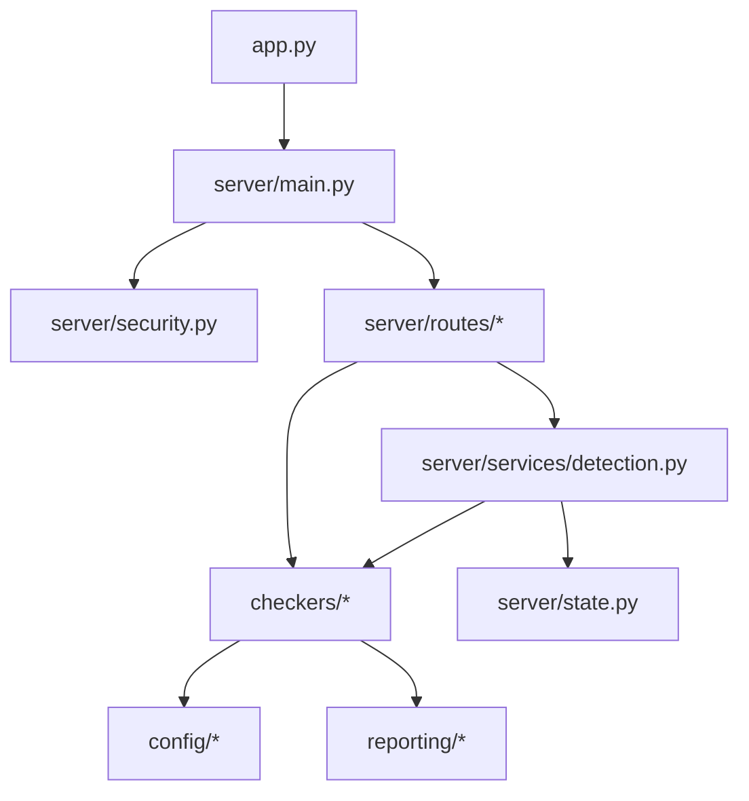
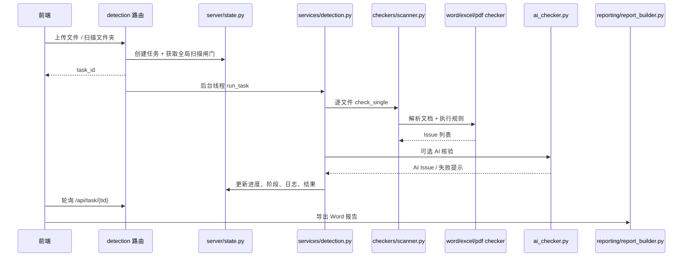

# 文档核验中心 V2 AI 版：项目结构与代码分析报告

- 分析对象：`E:\AIsoftware\文档核验AI`
- Git 分支：`refactor/backend-structure`
- 当前提交：`49d61f7 feat(知识库): 检索/问答记录持久化与管理（逐条 + 整体）`
- 分析日期：2026-10-22；修复更新：2026-10-23
- 分析方式：静态代码阅读、目录盘点、OpenAPI 内省、编译检查、回归脚本、前端类型检查与生产构建
- 说明：本报告基于**当前工作区**；记录功能已提交到 `49d61f7`。本次已修复 P0 代码项，`knowledge.json` 已移出 Git 索引但保留本地文件，报告仍未提交。

---

## 一、结论摘要

这是一个功能完整度较高、正在从单文件后端向分层架构迁移的本地文档检测系统。核心能力包括 Word/Excel/PDF 规则检测、文字规范与语句通顺检测、自定义规则/词库、可选本地 AI 核验、AI 规则生成、本地 AI 自学、知识库 RAG、Word 报告导出，以及已实现但前端入口被隐藏的资产评估流水线。

整体判断：

| 维度 | 判断 |
| --- | --- |
| 功能广度 | 强，覆盖检测、规则、词库、AI、RAG、报告、资产评估 |
| 分层程度 | 中等偏上，后端已拆为 `server/routes`、`server/services`、`checkers`、`config`、`reporting` |
| 可运行性 | 当前 Python 编译、前端 typecheck、前端生产构建均通过 |
| 自动化验证 | 261/261 项回归检查通过（10 个脚本）；`test_kb_graph.py` 已恢复 11/11 |
| 主要风险 | 知识库真实正文仍在 Git 历史中、向量覆盖不完整、API 契约与测试体系不统一 |
| 合并建议 | P0 代码项已修复；提交前复核 `knowledge.json` 的历史清理与前端产物 |

最需要关注的结论：

1. **已修复**：记录删除单条/清空原先只要求 `kb.search`，只读访客可越权；现改为 `kb.delete`，并新增 13 项 HTTP 权限回归。
2. **已修复**：`GET /api/settings` 和 `GET /api/ai/status` 现对 `api_key` / `access_token` 脱敏；保存回传 `********` 时保留真实密钥，非管理员不能修改 AI、访问安全或角色。
3. **已处置**：`config/knowledge/knowledge.json` 已被移出 Git 索引并加入 `.gitignore`，本地文件保留；Git 历史中的旧正文仍需单独评估清理。
4. 当前知识库有 279 个分块，但 Chroma 中只有 146 个向量，且 `knowledge.json` 记录 `embed_model=none`，稠密检索覆盖并不完整。
5. **已修复**：`test_kb_graph.py` 的失败是 Windows 文件锁和清理函数吞异常共同导致；现在关闭 Chroma 连接后再删除，测试 11/11 通过。
6. 后端路由文件仍保留从旧 `app.py` 拆分时复制的大量未使用导入，`server/routes/rag.py` 达到 526 行，维护成本偏高。

---

## 二、项目定位与运行形态

### 2.1 产品定位

「文档核验中心 V2 AI 版」是一个默认离线、本机优先的文档低级错误检查工具：

- 检测 Word `.docx`、Excel `.xlsx/.xlsm` 和文本型 PDF。
- 规则维度包括格式、文字规范、语句通顺、行业词库、自定义规则和可选 AI 语义核验。
- 支持把检测结果导出为 Word 报告。
- 知识库支持文档解析、切片、BM25/向量混合检索、溯源问答和检索记录。
- 支持本地 Ollama 或显式配置的 OpenAI 兼容接口。
- 通过浏览器工作区隔离不同用户的内存检测结果。

### 2.2 运行链路

```text
启动工具.bat / python app.py
        |
        v
server.main:app
        |
        +-- CORS + 访问口令中间件
        +-- 13 个业务路由
        +-- 资产评估路由
        +-- static/ 静态前端（最后挂载）
        |
        v
http://127.0.0.1:8501
```

前端构建产物在 `web/dist`，仓库中的 `static/` 是部署副本。当前 `static/` 包含 3 个文件，共约 466 KB：

- `static/index.html`
- `static/assets/index-BETZXPjl.js`（约 403 KB）
- `static/assets/index-BjQZWISR.css`（约 62 KB）

---

## 三、技术栈与环境

### 3.1 实际环境版本

| 组件 | 当前版本 |
| --- | --- |
| Python | 3.11.7 |
| FastAPI | 0.138.1 |
| Starlette | 1.3.1 |
| Pydantic | 2.13.4 |
| Uvicorn | 0.49.0 |
| ChromaDB | 1.5.9 |
| python-docx | 1.2.0 |
| openpyxl | 3.1.5 |
| pypdf | 6.16.0 |
| PyMuPDF | 1.28.2 |
| Pillow | 12.2.0 |
| Node.js | 24.16.0 |
| npm | 12.0.1 |
| React | 18.3.1 |
| Vite | 5.4.21 |
| TypeScript | 5.7.x |

### 3.2 依赖配置问题

- `requirements.txt` 写的是 `fastapi>=1.0`，但当前环境实际为 `0.138.1`，版本约束与实际安装不一致，重新安装时可能拉取不兼容的新版本。
- `rapidocr-onnxruntime` 写在依赖中，但当前未安装，OCR 引擎检测结果为不可用。PDF 扫描页和图片 OCR 在该环境下无法工作。
- `requirements.txt` 将 OCR 列为普通依赖，但产品文档又把扫描件描述为「自动跳过」，两者语义需要统一。
- 根目录的 `package.json` 和 `package-lock.json` 是空壳，真正的前端工程在 `web/`，容易误导新成员。

---

## 四、目录结构

```text
文档核验AI/
├─ app.py                       启动入口、监听地址、防火墙规则
├─ server/                      后端装配层
│  ├─ main.py                   FastAPI 应用、CORS、路由、静态资源
│  ├─ state.py                  路径常量、工作区、任务、扫描闸门
│  ├─ security.py               访问口令中间件
│  ├─ services/                 业务执行层
│  │  ├─ detection.py           检测执行、缓存、序列化
│  │  └─ ai.py                  AI 服务辅助
│  └─ routes/                   13 个 APIRouter
├─ checkers/                    检测与 AI 核心
│  ├─ base.py                   Issue / FileResult / 文件类型
│  ├─ scanner.py                批量检测调度
│  ├─ word_checker.py           Word 检测
│  ├─ excel_checker.py          Excel 检测
│  ├─ pdf_checker.py            PDF 检测
│  ├─ textnorm_checker.py       文字规范
│  ├─ fluency_checker.py        语句通顺
│  ├─ custom_rules.py           自定义规则引擎
│  ├─ wordbank.py               自定义词库引擎
│  ├─ ai_checker.py             AI 核验、提示词、连接、缓存
│  ├─ ai_builder.py             AI 规则/词库生成
│  ├─ ai_memory.py              本地 AI 自学
│  ├─ template_parser.py        范本解析
│  ├─ rule_scan.py              规则/词库扫描清理
│  ├─ rag_store.py              RAG 兼容门面
│  ├─ rag/                      RAG 分层实现
│  └─ valuation/                资产评估流水线
├─ config/                      规则、设置、词库、知识库、AI 记忆
├─ reporting/                   Word 报告生成
├─ schemas/                     Pydantic API 契约（当前未接入路由）
├─ web/                         React + TypeScript 前端
├─ static/                      前端部署产物
├─ tests/                       自检与回归脚本
├─ scripts/                     工具脚本
└─ docs/                        设计与分析文档
```

### 4.1 关键规模

| 区域 | 观察 |
| --- | --- |
| 后端路由 | 13 个文件，`rag.py` 526 行，`ai_memory.py` 417 行 |
| 检测器 | 56 个 Python 文件；`valuation/rules.py` 2177 行，`ai_checker.py` 1521 行 |
| RAG | 13 个模块，`engine.py` 1441 行 |
| 报告 | `reporting/report_builder.py` 934 行 |
| 前端 | 47 个 `.tsx`、9 个 `.ts`；`KbPage.tsx` 1736 行，`types.ts` 1153 行 |
| 配置 | `knowledge.json` 约 165 KB，`rules.json` 包含 20+13+11+6 条内置规则 |

---

## 五、后端架构

### 5.1 分层关系



职责划分：

- `app.py`：只处理启动参数、监听地址和 Windows 防火墙放行。
- `server/main.py`：创建 FastAPI 实例、安装 CORS、注册路由器、最后挂载静态目录。
- `server/routes/*`：HTTP 参数解析、权限依赖、调用服务层。
- `server/services/detection.py`：检测执行、任务线程、缓存、结果序列化、规则统计。
- `checkers/*`：与 HTTP 无关的检测和 AI 核心逻辑。
- `config/*`：规则、设置、词库的本地读取与原子写入。
- `schemas/api_models.py`：定义了一套 Pydantic 契约，但**路由没有使用 `response_model`**。

### 5.2 应用装配

`server/main.py` 的关键点：

- 创建 `FastAPI(title="文档低级错误检查工具", version="2.0.0")`。
- 允许全部来源、全部方法和全部请求头跨域，并同时启用 `allow_credentials=True`。
- 安装访问口令中间件。
- 依次注册 13 个业务路由器，再注册资产评估路由器。
- 最后挂载 `static/`，避免覆盖 `/api/*`。

`server/routes/__init__.py` 中注册顺序为：

```text
security -> overview -> detection -> rules -> dicts -> scan
-> template -> settings -> ai_config -> ai_build -> ai_memory
-> rag -> report
```

### 5.3 全局状态

`server/state.py` 维护：

- `_WORKSPACES`：按浏览器 `X-Workspace` 隔离的检测结果，最多 200 个，只淘汰空工作区。
- `_SCAN_STATE`：最近一次规则/词库扫描结果。
- `_TEMPLATE_STATES`：按工作区隔离的范本解析草案。
- `_TASKS`：异步检测任务，最多 30 个，TTL 1 小时。
- `_SCAN_GATE`：全局只允许一个检测/文件夹扫描任务同时运行。

这些状态全部在内存中，服务重启即丢失。检测结果不会自动持久化，只有报告文件会落到 `reports/`。

### 5.4 访问安全

当前实际配置：

```json
{
  "role": "admin",
  "security": {
    "access_token": "",
    "listen": "127.0.0.1"
  }
}
```

- 默认只监听回环地址，访问口令为空，当前本机模式可接受。
- 访问口令非空时，所有 `/api/*` 请求必须携带 `X-Access-Token`，比较使用 `hmac.compare_digest`。
- `/api/security/ping` 免鉴权，用于探测是否需要口令。
- 角色是全局设置，不存在真正的用户账号体系；「多用户」主要是浏览器工作区隔离。

主要问题：

1. CORS 使用 `allow_origins=["*"]` + `allow_credentials=True`，范围过宽，且与凭据模式不规范。
2. 角色控制只在前端隐藏导航；后端设置、AI 配置、AI 自学等接口没有管理员校验。
3. 访问口令为空时，任何能访问端口的人都可以读取/修改设置。
4. 局域网模式下口令通过 HTTP 明文传输，没有 TLS。

---

## 六、API 地图

通过 `app.openapi()` 统计，当前共有 **94 个路径 / 104 个操作**（GET 39、POST 61、DELETE 4）。注意 FastAPI 当前版本使用懒加载路由器，直接统计 `app.routes` 会得到错误结果。

| 业务域 | 操作数 | 代表接口 |
| --- | ---: | --- |
| RAG 知识库 | 28 | `/api/rag/ask`、`/api/rag/search`、`/api/rag/upload`、`/api/rag/tree`、`/api/rag/graph`、`/api/rag/records` |
| AI 配置/日志/参考/技能 | 10 | `/api/ai/status`、`/api/ai/test`、`/api/ai/models`、`/api/ai/refs` |
| AI 规则生成 | 5 | `/api/ai/build/dialogue`、`/api/ai/build/doc`、`/api/ai/build/logs` |
| AI 自学 | 14 | `/api/ai_memory`、`/api/ai_memory/samples`、`/api/ai_memory/learned` |
| AI 活动日志 | 3 | `/api/activity/logs`、`/api/activity/logs/clear` |
| 资产评估 | 9 | `/api/valuation/upload`、`/api/valuation/run`、`/api/valuation/result/{tid}` |
| 检测任务 | 6 | `/api/upload`、`/api/task/{tid}`、`/api/scan_folder`、`/api/clear_data` |
| 总览/文件/问题 | 4 | `/api/overview`、`/api/files`、`/api/issues`、`/api/issue_state` |
| 规则/字典/词库 | 8 | `/api/rules`、`/api/custom_rules`、`/api/dictionaries`、`/api/wordbanks` |
| 规则扫描 | 4 | `/api/scan/start`、`/api/scan/last`、`/api/scan/clean`、`/api/scan/export` |
| 范本导入 | 5 | `/api/template/upload`、`/api/template/import`、`/api/template/select` |
| 设置 | 3 | `GET/POST /api/settings`、`/api/settings/restore` |
| 报告 | 1 | `/api/report` |
| 安全探针 | 1 | `/api/security/ping` |
| **合计** | **104** | **94 个路径** |

### 6.1 API 契约问题

- 所有业务路由都没有声明 `response_model`，OpenAPI 中大部分响应没有结构化 Schema。
- `schemas/api_models.py` 定义了 593 行 Pydantic 模型，但只被 `scripts/generate_ts_types.py` 使用。
- 前端同时维护手写 `web/src/lib/types.ts` 和生成的 `web/src/lib/schemas/api.d.ts`，存在双份契约。
- OpenAPI 只有 `valuation` 路由带 tag，其他接口没有分组标签。
- 新增的记录接口是典型的契约漂移案例：后端直接返回 `Dict[str, Any]`，前端新增了 `KbRecord*` 类型，但两者没有自动校验。

---

## 七、核心检测链路

### 7.1 流程



### 7.2 数据结构

`checkers/base.py` 定义核心对象：

- `Issue`：规则键、标题、严重级别、位置、详情、片段、建议、状态、来源、分类。
- `FileResult`：文件名、类型、大小、状态、错误信息、问题列表、统计。
- 文件状态：`pass` / `issue` / `error` / `unreadable` 等。

`server/services/detection.py` 负责：

- 将 `Issue` / `FileResult` 序列化为前端 JSON。
- 汇总文件数、问题数、严重度、来源分布。
- 维护检测缓存和规则统计。
- 在任务线程中更新 `server/state.py` 的任务快照。

### 7.3 规则与配置现状

`config/rules.default.json` 是完整默认基线：

| 类别 | 默认启用 |
| --- | ---: |
| Word | 20/20 |
| Excel | 13/13 |
| 文字规范 | 11/11 |
| 语句通顺 | 6/6 |

当前 `config/rules.json` 被用户配置改为：

| 类别 | 当前启用 |
| --- | ---: |
| Word | 18/20 |
| Excel | 13/13 |
| 文字规范 | 0/11 |
| 语句通顺 | 6/6 |

被关闭的 Word 规则是 `full_width_space`（多余全角空格）和 `trailing_space`（段尾多余空格）；11 条文字规范规则全部关闭。这直接导致自检脚本的覆盖结果从 20/20 变为 18/20，文字规范从 11/11 变为 0/11。

其他配置：

- 自定义规则：5 个分组，54 条规则。
- 自定义词库：3 个分组，26 个词条。
- 这些配置是运行时数据，属于用户环境，不应把「当前启用数」误认为代码能力上限。

---

## 八、知识库 RAG 子系统

### 8.1 模块分层

```text
checkers/rag/
├─ paths.py         路径常量
├─ text.py          分词、切片、章节路径
├─ bm25.py          BM25 索引
├─ vectors.py       向量生成与余弦
├─ fusion.py        RRF 融合、MMR
├─ stores.py        向量库抽象（Chroma / memory）
├─ parsers.py       多格式解析与 OCR 自检
├─ tree.py          树形目录
├─ permissions.py   角色与能力
├─ graph.py         知识图谱
├─ records.py       检索/问答记录
├─ prompts.py       问答提示词与防幻觉
├─ service.py       低耦合服务门面
└─ engine.py        索引、检索、问答编排
```

上层通过 `checkers/rag_store.py` 兼容门面访问，避免检测器和路由直接依赖具体实现。

### 8.2 索引与检索

- 支持 `.docx`、`.pdf`、`.txt`、`.md`、`.xlsx`、`.csv`、图片等格式；图片和扫描 PDF 依赖 OCR。
- 默认切片长度 500、重叠 100，并按标题生成章节路径。
- BM25 为必选路径；向量检索可选，嵌入模型通过 Ollama 调用。
- 融合使用 RRF；问答支持拒答、引用、严格取证和置信度过滤。
- 向量后端默认 Chroma，本地持久化；不可用时降级为 memory/JSON。

### 8.3 当前知识库状态

| 项目 | 当前值 |
| --- | --- |
| 文档数 | 10 |
| 分块数 | 279 |
| 目录数 | 3 |
| 向量后端 | Chroma |
| Chroma 向量数 | 146 |
| 向量维度 | 4096 |
| 解析出的嵌入模型 | `qwen3-embedding:latest` |
| `knowledge.json` 记录的 `embed_model` | `none` |
| `knowledge.json` 记录的 `embed_dim` | 0 |
| 实际启用检索 | `kb_enabled=true`、`kb_dense_in_verify=true`、`top_k=8` |

这说明当前索引是**部分稠密覆盖**：279 个分块只有 146 个向量。PDF 文档占 146 个分块，较晚加入的 9 份 Word 文档主要依赖 BM25。元数据与实际向量库不一致，建议执行一次全量重建并核对数量。

### 8.4 目录、权限与图谱

- 目录支持多级父子关系，移动时会阻止自环和环路。
- 角色：`admin`（管理员）、`operator`（核验操作员）、`viewer`（只读访客）。
- 能力：`kb.view`、`kb.search`、`kb.upload`、`kb.reindex`、`kb.delete`、`kb.manage`。
- 角色来自全局 `settings.role`，不是真正的多用户账号。
- 图谱包含文档节点、章节节点、层级边和关键词共现边；`GET /api/rag/graph` 支持按目录过滤。

### 8.5 记录功能（已提交到 `49d61f7`）

新增 `checkers/rag/records.py`，并在 `server/routes/rag.py` 增加 5 个接口：

- `GET /api/rag/records`：分页、按类型/关键词/时间筛选、整体统计。
- `GET /api/rag/records/export`：导出 JSON 或 Markdown。
- `GET /api/rag/records/{rid}`：查看完整记录。
- `DELETE /api/rag/records/{rid}`：删除单条。
- `DELETE /api/rag/records`：按类型或全部清空。

设计特点：

- 记录写入 `config/knowledge/records.json`，临时文件 + `os.replace` 原子保存。
- 最多保留 1000 条，超出后丢弃最旧记录。
- 列表接口不返回完整 `result`，详情接口才返回。
- 写入和捕获异常都被吞掉，避免影响问答/检索主流程。

问题与修复状态：

1. **已修复**：记录删除/清空原先只要求 `kb.search`，`viewer` 可越权；现改为 `kb.delete`，设计文档与前端按钮已同步，`test_kb_records_api.py` 覆盖 viewer/operator 403 与 admin 成功。
2. 记录保存完整 `result`，可能包含知识库原文，存在隐私和体积风险。
3. 虽然注释写「异步式落盘」，实际是请求返回前同步写文件。
4. **已补测试**：`tests/regression/test_kb_records.py` 覆盖模块层 33 项；新增 `test_kb_records_api.py` 13 项覆盖 HTTP 接口和角色边界。

---

## 九、AI 子系统

### 9.1 AI 核验

`checkers/ai_checker.py` 支持两种模式：

- `local`：Ollama `/api/chat`，默认 `http://127.0.0.1:11434`。
- `online`：OpenAI 兼容 `/chat/completions`，需要 `base_url` 和 `api_key`。

核验流程：

1. 提取文档纯文本。
2. 按 `max_chars` 分段，受 `max_requests` 限制。
3. 逐段请求模型，要求返回 JSON 问题数组。
4. 解析为 `Issue`，`rule_key=ai_verify`、`source=ai`。
5. 单段失败只产生弱提醒，不中断整体检测。

其他机制：

- 本地模式下单次超时下限为 300 秒，避免慢模型被误判超时。
- 通过信号量限制并发，按 `rate_limit.rpm` 做粗略节流。
- 支持响应缓存、重试、深度复核、严格取证、置信度过滤和专项技能。
- 支持参考资料目录 `config/ai_refs`，核验时携带。
- 支持知识库检索注入，当前 `kb_enabled=true`、`top_k=8`、`kb_dense_in_verify=true`。

当前本地配置：

| 参数 | 值 |
| --- | --- |
| AI 总开关 | 开启 |
| 模式 | 本地 Ollama |
| 地址 | `http://127.0.0.1:11434/` |
| 模型 | `qwen3:8b` |
| 角色 | 由 `ai.role` 配置 |
| 深度复核 | 开启 |
| 严格取证 | 开启 |
| 最低置信度 | 0.6 |
| 启用技能 | 财务数据勾稽、术语一致性 |

本机 Ollama 实际可用模型包括 `qwen3:8b`、`qwen3-embedding:latest`、`embeddinggemma:latest`、`deepseek-r1:8b`。

### 9.2 AI 规则/词库生成

`checkers/ai_builder.py` 支持：

- 对话式生成：自然语言需求 -> 词库分组 + 规则 JSON。
- 文档生成：上传规范/标准文档 -> 提取术语和规则。
- 输出先在前端预览，用户确认后再写入自定义词库/规则。

限制：

- 最多 40 个词库条目、30 条规则。
- 生成后经过 `rule_filter` 过滤，避免生成「匹配内容和替换内容相同」的无效规则。

### 9.3 本地 AI 自学

`checkers/ai_memory.py` 的设计原则较严格：

- 必须同时具备系统留存的原始文档和用户上传的人工修订文档。
- 仅调用本地 Ollama，零联网。
- 只存储差异片段，不完整存储整篇文档。
- 学习产出合并到 `wordbanks.json` 和 `custom_rules.json`，标记 `source=ai_learning`。
- 学习数据保存在 `config/ai_memory/`，不出现在检测结果和报告中。

### 9.4 AI 安全风险

- `GET /api/ai/status` 直接返回 `load_settings()["ai"]`，包含 `api_key`。
- `GET /api/settings` 返回全部设置，同样包含 `api_key`。
- AI 配置、AI 自学、参考资料管理等后台接口没有服务端管理员校验。
- 前端导航隐藏 `aiconfig` 只是视觉限制，不构成授权。
- 在线 AI 模式下，待核验文本会发送到用户配置的第三方接口；产品虽在设置中说明，但报告和日志应避免记录密钥或完整敏感文本。

---

## 十、资产评估子系统

### 10.1 能力

`checkers/valuation/` 实现了一套独立的资产评估报告核查流水线：

- 四阶段闭环。
- 9 个处理节点。
- 96 个检查项。
- 包含上传、运行、任务查询、取消、结果、报告、重置、会话列表等 9 个 API。

模块包括：

- `valuation_api.py`：HTTP 接口。
- `pipeline.py`：流水线编排。
- `rules.py`：2177 行检查规则。
- `preprocess.py`、`splitter.py`：预处理与切分。
- `ai_nodes.py`、`review.py`：AI 节点和复核。
- `report_builder.py`：资产评估报告生成。
- `sheetio.py`、`dedup.py`：表格读写和去重。

### 10.2 当前状态

- API 已挂载在 `/api/valuation/*`，OpenAPI 中有 9 个操作。
- 前端 `web/src/pages/ValuationPage.tsx` 仍存在，但 `App.tsx` 没有导入它。
- `NAV` 中没有 `valuation` 项，并明确注释「已隐藏；保留页面与 API 以备后续启用」。

因此这是一个**前后端不同步的孤儿模块**：前端页面不可达，但后端接口仍暴露。若短期不启用，建议移除或加显式开关；若计划启用，需要补导航、权限和端到端测试。

---

## 十一、前端架构

### 11.1 页面与路由

前端使用 hash 路由，不依赖 React Router。

| 导航键 | 页面 | 可访问性 |
| --- | --- | --- |
| `overview` | `OverviewPage.tsx` | 是 |
| `detection` | `DetectionPage.tsx` + 5 个 Tab | 是 |
| `unified` | `UnifiedPage.tsx` + 5 个 Tab | 是 |
| `kb` | `KbPage.tsx` | 是 |
| `aiconfig` | `AiConfigPage.tsx` | 仅管理员导航可见 |
| `admin` | `AdminPage.tsx` | 是 |
| `settings` | `SettingsPage.tsx` | 是 |
| `valuation` | `ValuationPage.tsx` | **不可达，未导入 App** |

检测页 Tab：导入与检测、文件列表、错误详情、核验中、报告导出。
统一管理 Tab：规则总览、词库总览、批量导入、AI 规则生成、一键扫描清理。

### 11.2 状态与组件

- `TaskProvider` 管理异步任务轮询。
- `AccessGate` 处理访问口令。
- `ErrorBoundary` 对单个页面降级，避免整站白屏。
- `ToastProvider`、`OverlayProvider` 提供全局提示和浮层。
- 主题由 `lib/theme.ts` 和 `SettingsPage` 控制。
- 工作区 ID 随机生成并存放在 `localStorage`，每个请求带 `X-Workspace`。

### 11.3 构建与类型

当前验证结果：

- `npm run typecheck`：通过。
- `npm run build`：通过，Vite 转换 79 个模块。
- 产物：`index-BETZXPjl.js` 380.81 KB（gzip 116.93 KB），`index-BjQZWISR.css` 62.04 KB（gzip 11.68 KB）。

需要注意：

- `KbPage.tsx` 1736 行，承担目录树、上传、检索、问答、图谱、权限、记录等多类职责，后续应拆分。
- `types.ts` 1153 行且与 `schemas/api.d.ts` 重复。
- 当前记录功能已能通过 typecheck，模块层回归 33/33 通过；尚缺 HTTP 接口测试和前端 E2E 测试。
- `ValuationPage.tsx` 762 行是未使用的死代码。

---

## 十二、配置、数据与隐私

### 12.1 数据目录

| 路径 | 内容 | Git 状态 |
| --- | --- | --- |
| `config/settings.json` | 运行设置、AI Key、访问口令 | 被忽略 |
| `config/rules.json` | 当前内置规则启停 | 跟踪 |
| `config/rules.default.json` | 默认规则基线 | 跟踪 |
| `config/custom_rules.json` | 自定义规则 | 跟踪 |
| `config/wordbanks.json` | 自定义词库 | 跟踪 |
| `config/knowledge/knowledge.json` | 知识库元数据 + 分块正文 | **已移出索引，本地保留；已忽略** |
| `config/knowledge/chroma/` | Chroma 向量库 | 忽略 |
| `config/knowledge/files/` | 知识库上传原文 | 忽略 |
| `config/knowledge/records.json` | 检索/问答记录 | 忽略 |
| `config/ai_refs/` | AI 参考资料 | 忽略 |
| `config/ai_memory/` | AI 学习样本与产出 | 忽略 |
| `reports/` | 生成的 Word 报告 | 忽略 |
| `cache/` | 本机缓存 | 忽略 |
| `logs/` | 运行日志 | 忽略 |
| `static/` | 前端构建产物 | 跟踪 |
| `web/dist/` | 前端构建目录 | 忽略 |

### 12.2 隐私风险

1. **已处置**：`knowledge.json` 已移出 Git 索引并加入 `.gitignore`，包含 10 份文档名称和 279 个分块的正文/上下文仍保留在本地；Git 历史中的旧提交仍含该文件，清理历史需单独评估。
2. `config/knowledge/knowledge.json.git_baseline_backup` 已被忽略；主文件现在也不会再被新提交跟踪。
3. `records.json` 保存完整问答结果，可能包含知识库原文；虽然有 1000 条上限，但没有大小上限和脱敏。
4. `settings.json` 中的在线 AI `api_key` 仍是明文存储；HTTP 响应已脱敏，但本机文件读取者仍可看到。
5. 访问口令、API Key 都存在 `localStorage`，在共享电脑或 XSS 场景下有泄露风险。
6. 默认关闭 AI、只监听回环是正确的离线默认值；但一旦打开局域网，上述问题会被放大。

---

## 十三、验证结果

### 13.1 已执行检查

| 检查 | 命令 | 结果 |
| --- | --- | --- |
| Python 编译 | `python -m compileall -q app.py server checkers config reporting schemas scripts tools` | 通过 |
| 前端类型 | `npm run typecheck` | 通过 |
| 前端生产构建 | `npm run build` | 通过 |
| RAG 管线回归 | `python tests/regression/test_rag_pipeline.py` | 39/39 |
| 知识库模块回归 | `python tests/regression/test_kb_module.py` | 54/54 |
| 知识图谱回归 | `python tests/regression/test_kb_graph.py` | 11/11 |
| 记录模块回归 | `python tests/regression/test_kb_records.py` | 33/33 |
| 记录接口权限 | `python tests/regression/test_kb_records_api.py` | 13/13 |
| 密钥脱敏 | `python tests/regression/test_settings_secrets.py` | 21/21 |
| AI 报告合并 | `python tests/regression/test_ai_merge.py` | 31/31 |
| 专项技能报告 | `python tests/regression/test_skill_report.py` | 7/7 |
| 生成流程 | `python tests/regression/test_build_flow.py` | 23/23 |
| 自学流程 | `python tests/regression/test_learn_flow.py` | 29/29 |
| 检测自检 | `python tests/run_check_test.py` | 可运行，生成 48.6 KB Word 报告 |

合计回归检查：**261/261 通过**。这些是自定义脚本，不是 pytest 测试套件，也没有 CI 配置。

### 13.2 知识图谱失败分析与修复

原失败项：`空库返回空图谱`。

调用链：

```text
test_kb_graph.build()
  -> eng.invalidate()
  -> _rmtree(.tmp_kbgraph)
  -> graph.build_graph()
```

根因：

- Chroma 的 `chroma.sqlite3` 在测试进程中仍被打开。
- Windows 不允许删除已被打开的文件。
- 测试的 `_rmtree` 捕获 `OSError` 后直接 `pass`。
- 目录删除失败，但测试继续执行，于是「空库」仍然加载到旧的 `knowledge.json`。
- 诊断显示：删除后 `knowledge.json` 仍存在，图中仍有 10 个节点。

这不是图谱构建逻辑错误，而是测试隔离和资源释放问题。现已完成：

1. `ChromaStore.close()` 显式释放 `PersistentClient` 与 SQLite 连接，并兼容旧版 `chromadb`。
2. `_rmtree` 在删除前调用 `eng.invalidate()` 与 `stores.reset_store()`，失败时重试并最终抛错，不再吞异常。
3. 测试结束时再次清理临时目录，避免残留。
4. 回归结果恢复为 11/11。

### 13.3 自检脚本的有效性问题

`tests/run_check_test.py` 当前输出：

- Word 命中 18/20，未命中 `full_width_space`、`trailing_space`。
- Excel 命中 13/13。
- 文字规范命中 0/11。
- 语句通顺命中 6/6。
- PDF 文本样例命中 0 条。
- 自定义规则命中 0 条，期望的「禁用口语词『咱们』」「禁止使用全角逗号后接空格」未命中。
- 自定义词库命中 0 条，期望的 `_tmp`、`TODO` 未命中。
- 报告仍成功生成，脚本返回 0。

问题：

- 大量「未命中」只打印警告，不影响退出码，不能作为回归门禁。
- 当前 `config/custom_rules.json` 和 `config/wordbanks.json` 已与自检样例脱节。
- 文字规范规则全部关闭，导致 0/11 看似失败，实际是配置状态。
- PDF 有效样例 0 命中，说明 PDF 规则覆盖没有被真正验证。
- 应把期望命中写成断言，并在 CI 中使用干净的默认配置运行。

### 13.4 OCR 状态

解析器自检结果：

- 纯文本、Word、Excel、PDF、CSV：可用。
- 图片 OCR：不可用。
- OCR 引擎：`rapidocr`、`paddleocr`、`tesseract` 均未安装。
- 当前 `ocr_enabled=true`，但实际没有可用引擎。

这意味着知识库中的扫描 PDF 和图片实际上无法完成 OCR；产品文案需要明确「未安装 OCR 时跳过/不可用」。

---

## 十四、当前工作区与最新提交

### 14.1 当前状态

最新提交 `49d61f7` 已包含记录功能。本次修复后的工作区变化：

```text
 M .gitignore
 M checkers/rag/stores/__init__.py
 M checkers/rag/stores/chroma_store.py
 M config/settings_manager.py
 M server/routes/rag.py
 M server/routes/settings.py
 M server/routes/ai_config.py
 M tests/regression/test_kb_graph.py
 M web/src/pages/KbPage.tsx
 M web/src/pages/SettingsPage.tsx
 M web/src/pages/AiConfigPage.tsx
D  config/knowledge/knowledge.json   # 仅移出索引，本地文件保留
?? docs/项目结构分析报告.md
?? tests/regression/test_kb_records_api.py
?? tests/regression/test_settings_secrets.py
```

`knowledge.json` 已加入 `.gitignore` 并从 Git 索引移除，本地知识库仍可正常加载；本报告与两个新增回归脚本仍未提交。

### 14.2 最新提交内容

提交 `49d61f7` 共修改 14 个文件，新增约 1186 行、删除约 62 行，核心内容包括：

- 新增 `checkers/rag/records.py`：持久化、分页、筛选、统计、详情、删除、清空、JSON/Markdown 导出。
- `rag_store.py`：导出记录相关函数。
- `routes/rag.py`：新增 5 个记录接口，并在 ask/search 后捕获记录。
- `api.ts` / `types.ts`：新增前端记录客户端与类型。
- `KbPage.tsx`：新增记录列表、筛选、详情弹窗、重新执行、导出、清空。
- `tests/regression/test_kb_records.py`：新增记录模块回归测试，33/33 通过。
- `docs/知识库模块集成方案.md`：补充记录模块设计说明；本次已把删除/清空权限同步为 `kb.delete`。
- `static/`：重新构建的前端产物。
- `.gitignore`：忽略 `records.json` 和临时文件。

### 14.3 合并前复核项

1. **已完成**：记录删除/清空改为 `kb.delete`；设计文档同步；新增 13 项 HTTP 权限测试。
2. **已完成**：设置与 AI 状态接口脱敏，回传掩码保存时保留原密钥；非管理员禁止修改 AI、访问安全与角色。
3. **已完成**：`knowledge.json` 加入 `.gitignore` 并移出 Git 索引，本地文件保留；历史清理需单独评估。
4. **已完成**：`static/` 新产物与源码一致；`npm run build` 通过。
5. **已完成**：`records.json` 只存在于本地，当前未被跟踪。

---

## 十五、风险与改进建议

### 15.1 P0：合并/发布前必须处理

| 编号 | 问题 | 影响 | 建议 | 状态 |
| --- | --- | --- | --- | --- |
| P0-1 | 记录删除/清空权限过宽 | 只读访客可删除全部记录 | 改为 `kb.delete`；补 403 测试 | 已修复 |
| P0-2 | 设置与 AI 状态接口泄露 API Key | 局域网用户可读取在线 AI 密钥 | 响应脱敏；掩码保存保留真实值；限制非管理员修改 | 已修复 |
| P0-3 | `knowledge.json` 曾跟踪真实知识库正文 | 业务资料进入 Git 历史 | 移出版本控制；历史清理单独评估 | 已移出索引，历史待清理 |
| P0-4 | `test_kb_graph.py` 失败 | 回归门禁不可信 | 释放 Chroma 连接后再清理，禁止吞异常 | 已修复 |

### 15.2 P1：近期应处理

| 编号 | 问题 | 建议 |
| --- | --- | --- |
| P1-1 | API 契约未接入 | 为路由增加 `response_model`，统一由 `schemas/api_models.py` 生成前端类型 |
| P1-2 | 路由文件重复导入严重 | 清理 `server/routes/*` 的复制粘贴导入；按需拆服务 |
| P1-3 | 当前向量覆盖不完整 | 全量重建知识库，核对 279 分块与向量数；修正 `embed_model` 元数据 |
| P1-4 | 自检脚本不断言 | 让 `run_check_test.py` 在期望未命中时返回非 0；使用默认配置跑 CI |
| P1-5 | 设置/AI 接口无角色校验 | 设置写入已加字段级保护；AI 其他接口仍未统一管理员依赖 |
| P1-6 | OCR 依赖未安装 | 明确可选依赖；UI 显示不可用原因；安装后再宣称扫描件 OCR 能力 |
| P1-7 | `requirements.txt` 约束异常 | 将 `fastapi>=1.0` 改为与实际兼容的版本范围，并锁定测试矩阵 |
| P1-8 | 记录 API 权限边界未测试 | 已补 `test_kb_records_api.py` 13 项；可继续加前端 E2E |

### 15.3 P2：结构性改进

| 编号 | 问题 | 建议 |
| --- | --- | --- |
| P2-1 | `ValuationPage` 孤儿化 | 明确启用或移除；若保留，补导航、权限、测试 |
| P2-2 | 大文件集中 | 拆分 `KbPage.tsx`、`ai_checker.py`、`rag/engine.py`、`valuation/rules.py` |
| P2-3 | 结果仅存内存 | 增加任务/结果持久化选项，避免重启丢失 |
| P2-4 | 工作区淘汰不彻底 | 对非空工作区也设置 TTL 或总内存上限 |
| P2-5 | 记录同步写盘 | 改为队列/后台写入，限制单条结果大小 |
| P2-6 | 缺少可观测性 | 增加结构化日志、耗时指标、任务失败率、知识库索引健康度 |
| P2-7 | 根目录杂物 | 清理空 `package.json`、临时目录和一次性脚本 |
| P2-8 | 安全传输 | 局域网模式建议启用 HTTPS 或反向代理，口令不要明文传输 |

---

## 十六、建议的后续动作

按优先级建议：

1. **P0 已处理**：记录权限、API Key 脱敏、知识库数据出库、图谱测试清理均已完成；`knowledge.json` 的 Git 历史清理待单独评估。
2. **补记录权限测试**：模块层 33 项与 HTTP 权限 13 项均已通过；可继续覆盖导出内容、空库、1000 条上限的前端 E2E。
3. **建立统一验证入口**：把 10 个回归脚本收拢为 pytest 或统一 runner，CI 执行 `compileall + pytest + npm typecheck + npm build`。
4. **统一 API 契约**：先用 `response_model` 覆盖核心检测、知识库、记录接口，再生成前端类型，移除手写重复类型。
5. **重建知识库索引**：确认 279 个分块全部完成嵌入，或明确标注哪些文档仅 BM25。
6. **决定资产评估模块去留**：隐藏 API 仍暴露会增加攻击面；不启用就移除或加开关。
7. **整理仓库**：保持 `config/knowledge/knowledge.json` 为本地数据，仓库只保留结构样例；同时评估清理历史提交。

---

## 附录 A：关键文件索引

| 文件 | 作用 |
| --- | --- |
| `app.py` | 启动与监听配置 |
| `server/main.py` | FastAPI 装配、CORS、静态资源 |
| `server/state.py` | 工作区、任务、扫描闸门 |
| `server/security.py` | 访问口令 |
| `server/routes/__init__.py` | 路由注册表 |
| `server/routes/detection.py` | 上传、任务、扫描、清理 |
| `server/routes/rag.py` | 知识库 API，记录功能所在 |
| `server/services/detection.py` | 检测执行与序列化 |
| `checkers/scanner.py` | 批量检测调度 |
| `checkers/base.py` | Issue / FileResult |
| `checkers/ai_checker.py` | AI 核验 |
| `checkers/ai_memory.py` | AI 自学 |
| `checkers/rag/engine.py` | RAG 编排 |
| `checkers/rag/records.py` | 检索/问答记录 |
| `tests/regression/test_kb_records.py` | 记录模块回归测试 |
| `tests/regression/test_kb_records_api.py` | 记录 HTTP 接口与角色权限回归 |
| `tests/regression/test_settings_secrets.py` | 设置/AI 密钥脱敏与保存保护回归 |
| `checkers/valuation/valuation_api.py` | 资产评估 API |
| `reporting/report_builder.py` | Word 报告 |
| `schemas/api_models.py` | Pydantic 契约 |
| `web/src/App.tsx` | 前端路由与页面装配 |
| `web/src/pages/KbPage.tsx` | 知识库管理台 |
| `web/src/lib/api.ts` | API 客户端 |
| `web/src/lib/types.ts` | 前端类型 |
| `config/settings_manager.py` | 设置默认值与读写 |
| `config/rules.json` | 当前规则启停 |
| `config/knowledge/knowledge.json` | 知识库数据（本地运行数据，已忽略） |

## 附录 B：验证命令速查

```powershell
# Python 编译
python -m compileall -q app.py server checkers config reporting schemas scripts tools

# 回归
python -X utf8 tests/regression/test_rag_pipeline.py
python -X utf8 tests/regression/test_kb_module.py
python -X utf8 tests/regression/test_kb_graph.py
python -X utf8 tests/regression/test_kb_records.py
python -X utf8 tests/regression/test_kb_records_api.py
python -X utf8 tests/regression/test_settings_secrets.py
python -X utf8 tests/regression/test_ai_merge.py
python -X utf8 tests/regression/test_skill_report.py
python -X utf8 tests/regression/test_build_flow.py
python -X utf8 tests/regression/test_learn_flow.py

# 自检（当前不会因未命中而失败）
python -X utf8 tests/run_check_test.py

# 前端
cd web
npm run typecheck
npm run build
```

---

**报告结论：** 项目已经具备可用的检测、AI、RAG 和报告能力，后端分层方向正确，前端生产构建正常。本次已修复记录越权、密钥泄露、图谱测试隔离，并将知识库真实数据移出版本控制；剩余重点是清理 Git 历史、修正向量覆盖与统一 API/测试契约。
